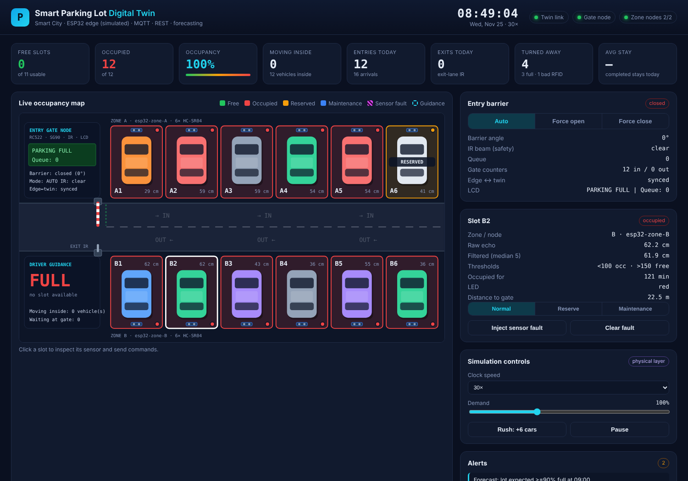
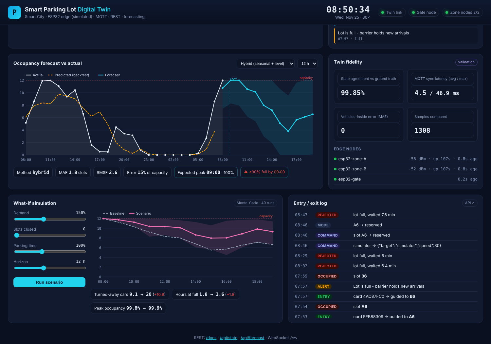

# Smart Parking Lot Digital Twin (Simulation-based)

**Project 5 — Domain: Smart City — Level: Intermediate**

A real-time digital twin of a 12-slot parking lot (Zone A + Zone B, one ESP32 per zone). It shows slot occupancy on a live 2D map, guides drivers to free slots, logs entries and exits, forecasts hourly occupancy and controls the entry barrier automatically.

The **physical layer is fully simulated** instead of using real hardware. The simulator speaks exactly the same MQTT protocol as the ESP32 firmware, so the twin engine and dashboard work unchanged with simulated nodes, with the firmware running in the Wokwi ESP32 simulator, or with real boards.



## Architecture

```
┌──────────────── Physical layer (SIMULATED) ────────────────┐
│ simulator/physical_sim.py           firmware/ (Wokwi ESP32) │
│  • 2× ESP32 zone node: 6× HC-SR04 each (noise, outliers)   │
│  • ESP32 gate node: RC522, SG90 barrier, IR, 16×2 LCD      │
│  • traffic: Poisson arrivals, queue, guidance, stays       │
└───────────────┬────────────────────────────────▲───────────┘
   MQTT  zone/+/telemetry · gate/event · gate/state   twin/availability · gate/cmd · slot/+/cmd
┌───────────────▼────────────────────────────────┴───────────┐
│ Twin engine  (twin/engine.py)                               │
│  state mirror · sensor fusion · guidance · SQLite log ·     │
│  hourly aggregation · forecasting · what-if · alerts        │
└───────────────┬────────────────────────────────────────────┘
        REST + WebSocket (FastAPI)
┌───────────────▼────────────────────────────────────────────┐
│ Dashboard (dashboard/) – live 2D map, forecast vs actual,  │
│ what-if, barrier & slot commands, event log, fidelity      │
└────────────────────────────────────────────────────────────┘
```

## Quick start (Windows / Linux / macOS)

Requires Python 3.10+.

```bash
git clone https://github.com/Mohamedadel-prog/smart-parking-digital-twin.git
cd smart-parking-digital-twin
python -m venv .venv
.venv\Scripts\activate          # Windows   (Linux/macOS: source .venv/bin/activate)
pip install -r requirements.txt
python run_all.py
```

The dashboard opens at `http://localhost:8000`. `run_all.py` starts three processes:

| Process | Command | Role |
|---|---|---|
| MQTT broker | `python -m broker.embedded_broker` | Pure-Python broker (no Mosquitto install needed) |
| Twin engine | `python -m twin.engine` | Digital twin + REST API + WebSocket + dashboard |
| Physical simulator | `python -m simulator.physical_sim` | Virtual ESP32 nodes, sensors and vehicles |

Useful options:

```bash
python run_all.py --speed 120      # faster clock (60 = 1 real second is 1 simulated minute)
python run_all.py --reset          # delete the database and regenerate history (use before a demo)
python run_all.py --no-broker      # use an existing Mosquitto (docker compose up -d)
python run_all.py --no-sim         # physical layer comes from Wokwi / real ESP32
```

The simulated day starts at 06:00 so the morning rush, the lot filling up and the barrier closing are visible within a few minutes. On first start the twin generates 14 days of **synthetic history** with the same demand model so forecasting works immediately. Live data is then recorded on top of it.

## How the objectives are met

| Objective | Implementation |
|---|---|
| Detect vehicle presence in at least 6 slots | 12 slots. Each HC-SR04 is pinged 5 times → **median filter** → **hysteresis** (< 100 cm occupied, > 150 cm free) → **debounce** (2 confirmations). Too few valid echoes → **sensor fault** |
| Live 2D map with colour-coded slots | SVG map: free / occupied / reserved / maintenance / sensor fault / offline, with live cars, queue and barrier animation |
| Guide drivers to free slots | The twin picks the nearest free slot to the gate (never sending two cars to the same slot) and publishes it to the gate: LCD shows "Go to A3" and an animated path appears on the map |
| Log entries/exits | SQLite `events` table (entry / exit / denied / rejected / slot changes / commands / alerts) |
| Forecast occupancy per hour | Moving average, seasonal moving average, hybrid (seasonal + level correction) and optional Prophet, with a rolling backtest (MAE / RMSE) |
| Control the entry barrier automatically | Opens only for a registered card **and** when space is available; closes automatically when full (LCD: PARKING FULL). **Safety interlock**: the arm never lowers while the IR beam is blocked |

## Additional digital-twin features

- **Sensor fusion**: vehicles inside (gate counters) − vehicles seen by slot sensors = vehicles still moving inside, so the free count is never over-reported.
- **Edge autonomy**: if the twin or network is down, the gate continues with local counting (LCD: "Offline mode").
- **What-if simulation**: Monte-Carlo (40 runs) starting from the current lot state, e.g. +50 % demand, 2 slots closed, shorter parking times — compared with a baseline.
- **Remote commands**: force open / close / auto for the barrier, reserve / maintenance for any slot.
- **Twin fidelity** (enabled by simulation): the simulator publishes ground truth, and the twin measures its own state agreement (%), MQTT latency and vehicles-inside error.
- **Fault injection**: break a sensor from the dashboard and watch the alert and blinking LED.



## Demo script (5 minutes)

1. Run `python run_all.py --reset`. It is 06:00, the lot is empty and guidance points to A1.
2. Wait until 08:00–09:00 (about 3 minutes at 60×). Cars enter and the LCD tells each driver where to park.
3. When the lot fills up, the barrier closes automatically, the LCD shows **PARKING FULL**, the queue grows and drivers who give up are logged as `rejected` — the expected result *"gate automatically closes when full"*.
4. Forecast chart: actual vs predicted, MAE and expected peak time.
5. What-if: set demand to 150 %, close 2 slots, run, and read the extra turned-away cars and hours at full.
6. Click a slot → *Inject sensor fault* (alert) or *Maintenance* (removed from the free count).
7. *Force close* the barrier, then back to *Auto* — the command appears in the log.

## REST API

Interactive docs (Swagger) at `http://localhost:8000/docs`.

| Method | Endpoint | Description |
|---|---|---|
| GET | `/api/state` | Full snapshot (slots, gate, KPIs, alerts, fidelity) |
| GET | `/api/slots`, `/api/slots/{id}` | Slot states |
| GET | `/api/events?limit=&type=` | Entry/exit log |
| GET | `/api/history?hours=48` | Hourly occupancy |
| GET | `/api/forecast?method=hybrid&horizon=12` | Forecast + backtest + metrics |
| GET | `/api/forecast/compare` | Accuracy of every forecasting method |
| GET | `/api/summary` | Today's KPIs |
| POST | `/api/gate` `{"mode":"auto\|open\|closed"}` | Remote barrier command |
| POST | `/api/slots/{id}/mode` `{"mode":"normal\|reserved\|maintenance"}` | Slot command |
| POST | `/api/whatif` `{"demand":1.5,"closed_slots":2,"stay_mult":1,"hours":12}` | What-if scenario |
| POST | `/api/sim` `{"speed":120,"demand":1.3,"rush":6,"fault":"A3","clear_fault":"A3","pause":true}` | Simulator control |
| WS | `/ws` | Live snapshots |

## Wokwi mode (ESP32 firmware on a simulator)

The Arduino firmware is in `firmware/esp32_parking_node/`, with a Wokwi-ready copy in `firmware/wokwi/`.

1. Open https://wokwi.com and create a new ESP32 project.
2. Copy in `sketch.ino`, `diagram.json` and `libraries.txt` from `firmware/wokwi/`.
3. Change `PREFIX` in the sketch to something unique, e.g. `smartparking-yourname`.
4. On your PC, run the twin against the same public broker with Zone A only:
   ```bash
   # Windows PowerShell
   $env:MQTT_HOST="broker.hivemq.com"; $env:TOPIC_PREFIX="smartparking-yourname"; $env:LOT_ZONES="A"
   python run_all.py --no-broker --no-sim
   ```
5. In Wokwi, click an HC-SR04 and move its distance slider — the slot changes on the dashboard. **Scan registered card** opens the barrier, **Exit-lane IR** logs an exit and the slide switch simulates the IR beam under the barrier.

> Wokwi has no RC522 part, so cards are simulated with push buttons. On real hardware enable `#define USE_RC522`.

## Configuration

Set in `config.py` or as environment variables:

| Variable | Default | Meaning |
|---|---|---|
| `MQTT_HOST` / `MQTT_PORT` | `127.0.0.1` / `1883` | MQTT broker |
| `TOPIC_PREFIX` | `smartparking` | Root of every topic |
| `LOT_ZONES` | `A,B` | Zones (each zone = one ESP32 + 6 sensors) |
| `SIM_SPEED` | `60` | Simulation clock speed |
| `SIM_START_HOUR` | `6` | Hour the simulated day starts |
| `HISTORY_DAYS` | `14` | Days of synthetic history |

## Project structure

```
config.py                    shared configuration
run_all.py                   starts everything with one command
broker/embedded_broker.py    MQTT broker (amqtt)
common/model.py              demand model (arrivals / parking durations), shared by sim, history and what-if
common/layout.py             slot geometry
simulator/physical_sim.py    physical + edge layer simulation
twin/engine.py               twin engine + FastAPI
twin/forecasting.py          MA / seasonal / hybrid / Prophet + backtest
twin/whatif.py               Monte-Carlo what-if
twin/history.py              synthetic history bootstrap
twin/storage.py              SQLite persistence
dashboard/                   HTML/CSS/JS (no CDN, works offline)
firmware/                    ESP32 Arduino firmware + Wokwi diagram
docs/architecture.md         MQTT contract, algorithms, pin map, results
```

## Tech stack

Python · paho-mqtt · amqtt · FastAPI · Uvicorn · SQLite · vanilla JS/SVG · ESP32 (Arduino) · Wokwi

## Author

**Mohamed Adel** — [LinkedIn](https://www.linkedin.com/in/mohamed-adel08/)
